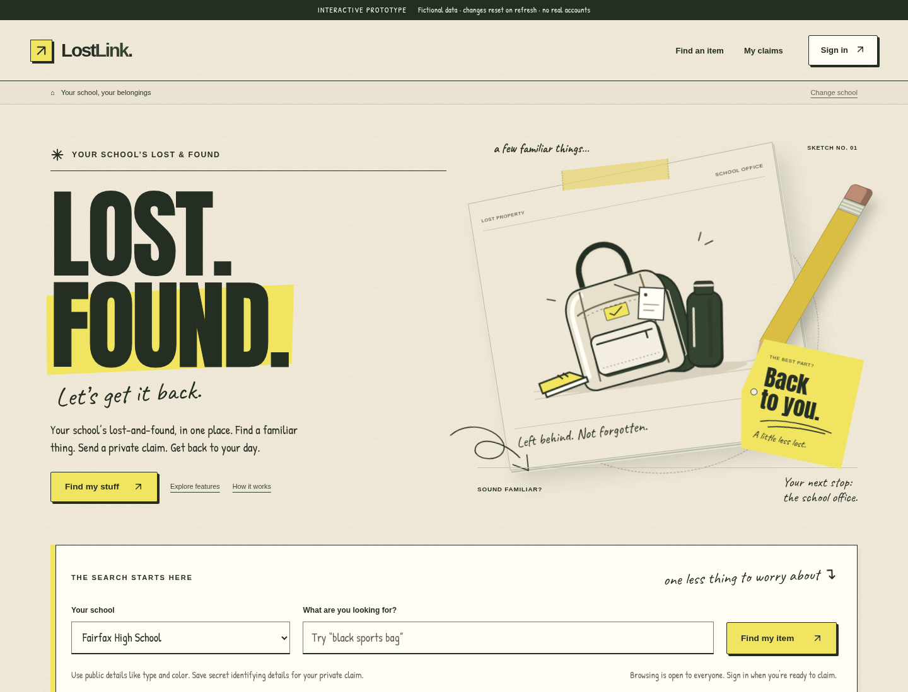
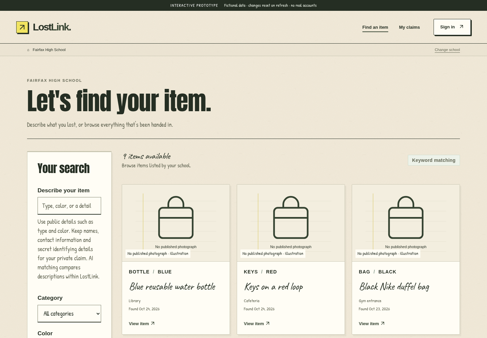

# Paper motion design review

A review of the November 2026 LostLink redesign, delivered on
`codex/paper-motion` for review before merging into `main`.

The homepage combines oversized ink typography, the existing original belongings
illustration, layered paper, a CSS 3D pencil, a floating tag and drawn motion.
The same fonts, controls, paper surfaces and ruled layouts carry through search,
item details, claims, staff inventory/review, account, authentication, recovery,
owner/school settings, policies and the not-found page.

## Screenshots

These captures use the local, fictional in-memory review harness. The prototype
banner and demo controls belong to that harness and do not ship on the live site.
Motion is paused for these static captures.

[Desktop home](home-desktop.png) · [Mobile home](home-mobile.png) ·
[Search](search-desktop.png)





## Try it locally

```sh
npm ci
node tools/phase2-preview.mjs
```

Open <http://127.0.0.1:4173>. Try Find my stuff, select a school and submit a
search, open an item and follow a claim. The fictional demo controls let you
switch between student and school staff without touching real accounts.
Use Pause animations in the footer, then navigate to another page. Device
reduced-motion settings also suppress decorative motion.

For native account, authentication and policy pages, use `npm run dev` and open
<http://localhost:3000/sign-in> or <http://localhost:3000/privacy>. Real account
and administrative workflows require the existing Supabase configuration.

## Review notes

- Assets and fonts are served locally; Anton's OFL is included.
- Decorative motion uses CSS and browser APIs, with cleanup on page changes.
- Search, role checks, private proof, auth forms and staff decisions retain their
  existing contracts. There are no database or API changes.
- Local browser checks cover public and mock claimant/staff journeys plus native
  pages. Real persisted Supabase workflows are left to the existing PR CI.
- This branch is for review. No production merge is authorized by this handoff.
